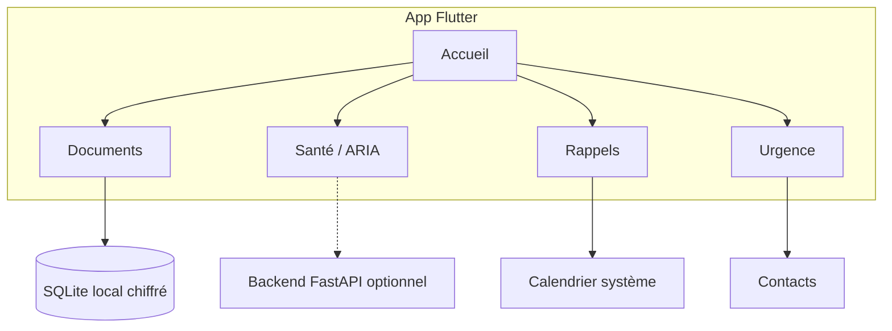

<div align="center">
  
</div>

<br>

# Arkalia CIA

Assistant mobile santé pour la gestion sécurisée de documents médicaux, rappels et contacts d’urgence — conçu pour une utilisation simple au quotidien (dont seniors).

| | |
|---|---|
| **Version** | `1.3.1` (`arkalia_cia/pubspec.yaml`) |
| **Stack** | Flutter (app) · Python / FastAPI (backend optionnel) |
| **Données** | Stockage local SQLite, chiffrement AES-256 |
| **Modèle** | Offline-first · privacy-first (pas de cloud obligatoire) |
| **Cibles** | Android · iOS · Web (développement) |
| **Licence** | MIT |

[](https://flutter.dev)
[](https://python.org)
[](LICENSE)
[](https://github.com/arkalia-luna-system/arkalia-cia/actions)

## Principes

- **Hors ligne** : l’essentiel fonctionne sans réseau.
- **Vie privée** : données sur l’appareil ; pas de collecte tierce imposée.
- **Lisibilité** : textes ≥ 14 sp, boutons larges, navigation claire.
- **Gratuit** : pas d’API payante requise pour le cœur produit.

## Fonctionnalités

| Module | Rôle |
|--------|------|
| **Documents** | Import PDF, organisation, recherche, stockage chiffré |
| **Santé** | Accès rapide aux portails médicaux |
| **Rappels** | Rappels locaux et intégration calendrier |
| **Urgence** | Contacts ICE et appels rapides |
| **ARIA** | Suivi douleur / patterns (intégré dans CIA) |
| **Profil & sync** | Profil multi-appareil, sync CIA ↔ ARIA (optionnelle) |

## Architecture (aperçu)



## Démarrage rapide

**Prérequis** : Flutter SDK compatible avec `environment` dans `arkalia_cia/pubspec.yaml` · Python 3.10+ (backend optionnel).

```bash
git clone https://github.com/arkalia-luna-system/arkalia-cia.git
cd arkalia-cia/arkalia_cia
flutter pub get
flutter run
```

Commandes utiles à la racine du dépôt :

```bash
make test          # suite de tests
make lint          # qualité de code
make build-android # APK
```

Détails déploiement : [`docs/deployment/DEPLOYMENT.md`](docs/deployment/DEPLOYMENT.md).

## Tests

Le dépôt contient une suite **pytest** (backend Python) et des tests **Flutter** (unit / widgets) sous `tests/` et `arkalia_cia/test/`. Lancer `make test` ou `flutter test` / `pytest` selon le périmètre. Les badges ou chiffres de couverture externes peuvent diverger selon la branche CI — se fier à la dernière exécution CI plutôt qu’à un pourcentage figé ici.

## Sécurité & confidentialité

- Chiffrement local des documents (AES-256).
- Mode offline-first : pas de dépendance cloud pour l’usage courant.
- PIN local (notamment web) ; permissions minimales.
- Politique : [`docs/POLITIQUE_CONFIDENTIALITE.md`](docs/POLITIQUE_CONFIDENTIALITE.md) · [`SECURITY.md`](SECURITY.md).

## Écosystème

**CIA** = coffre-fort santé (documents, rappels, urgence).  
**ARIA** = laboratoire douleur / mental, consolidé dans CIA (le dépôt `arkalia-aria` est en archivage progressif).

Vision : [`docs/integrations/ECOSYSTEM_VISION.md`](docs/integrations/ECOSYSTEM_VISION.md) · intégration : [`docs/integrations/ARIA_INTEGRATION.md`](docs/integrations/ARIA_INTEGRATION.md).

## Documentation

| Document | Contenu |
|----------|---------|
| [`docs/POUR_MAMAN.md`](docs/POUR_MAMAN.md) | Guide utilisateur |
| [`docs/ARCHITECTURE.md`](docs/ARCHITECTURE.md) | Architecture |
| [`docs/CHANGELOG.md`](docs/CHANGELOG.md) | Historique des versions |
| [`docs/CONTRIBUTING.md`](docs/CONTRIBUTING.md) | Contribution |
| [`AGENTS.md`](AGENTS.md) | Circuit agents / invariants projet |

## Licence & contact

MIT — voir [`LICENSE`](LICENSE).  
Issues : [GitHub Issues](https://github.com/arkalia-luna-system/arkalia-cia/issues) · contact : arkalia.luna.system@gmail.com

**Arkalia Luna System** · [GitHub](https://github.com/arkalia-luna-system)
